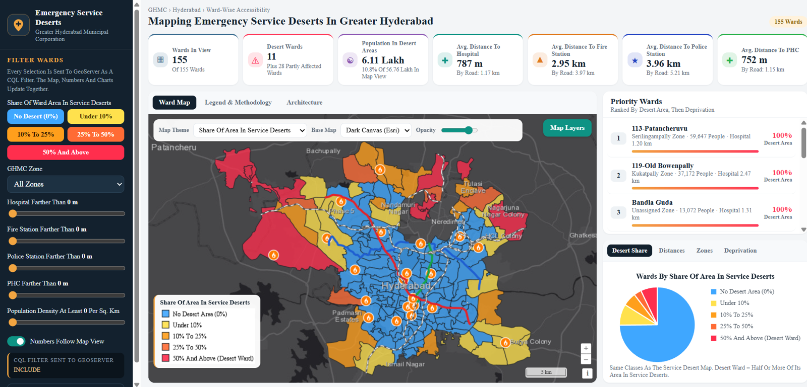
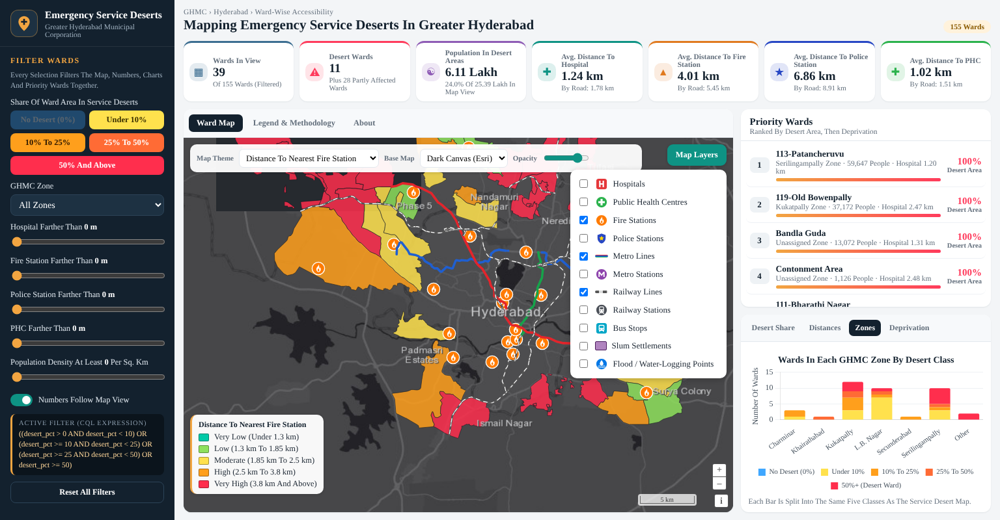

# Hyderabad Emergency Services Dashboard

**Mapping Emergency Service Deserts in Greater Hyderabad: a ward-wise Web GIS dashboard for the Greater Hyderabad Municipal Corporation (GHMC).**

### 🔗 Live Dashboard: **https://swapnanilsaha-gis.github.io/hyderabad-emergency-services-dashboard/**



---

## About

Timely access to hospitals, fire stations, police stations and public health centres is uneven across a fast-growing city. This dashboard identifies **emergency service deserts**, which are areas where poor access to emergency facilities coincides with high population demand and vulnerability. It presents them ward by ward for all **155 GHMC wards**.

The dashboard answers questions such as:
- Which wards have the largest share of their area and population inside service deserts?
- How far, on average, are residents from the nearest hospital, fire station, police station and PHC?
- How do access, population density, slums, flood points and deprivation vary across zones?

## Key Figures (GHMC, 2025)

| Indicator | Value |
|---|---|
| Wards analysed | 155 |
| Desert wards (50% or more of the area in service deserts) | 11 |
| Partly affected wards | 28 |
| Population living in service-desert areas | ≈ 6.11 lakh (10.8% of 56.76 lakh) |
| Average distance to nearest hospital / fire station / police station / PHC | 787 m / 2.95 km / 3.96 km / 752 m |

*Distances are population-weighted straight-line averages. Road-network distances are shown alongside them in the dashboard.*

## Features

- **Home map: Share Of Area In Service Deserts.** Five classes, from no desert area to desert wards.
- **Eight ward map themes:** desert share; distance to hospital, fire station, police station, PHC and metro/rail station; population density; deprivation score.
- **Map layers with dedicated icons:** hospitals, PHCs, fire stations, police stations, bus stops, metro stations and lines, railway stations and lines, slum settlements and flood / water-logging points.
- **Interactive filters:** desert class, GHMC zone, minimum distance to each facility type and minimum population density. The map, KPI cards, charts and rankings all update together.
- **KPI cards** that follow the current map view.
- **Priority Wards** ranked by desert share, then deprivation. Click a ward to zoom to it.
- **Charts:** desert-class share, distance by desert class, desert classes by zone, and deprivation by desert class.
- **Click popups** with full ward indicators and facility details.
- **Base maps:** Dark Canvas, Streets, Light Grey, Satellite (Esri) and OpenStreetMap.



## Methodology

1. **Data collection and processing:** ward and zone boundaries, hospitals, PHCs, fire and police stations, road network, bus and metro GTFS feeds, railways, WorldPop 2025 population, slums and flood points, processed in Python.
2. **Spatial analysis units:** a 1 km hexagonal grid over the GHMC area.
3. **Accessibility analysis:** straight-line and road-network distance from every hexagon to the nearest hospital, fire station, police station and PHC, plus facility counts within a service radius.
4. **Demand, vulnerability and transport:** population and density, slum share, flood points, and access to bus, metro and rail.
5. **Machine-learning clustering:** K-Means on the normalised indicators (cross-checked with GMM and DBSCAN), with a composite deprivation score, to identify service-desert cells.
6. **Ward aggregation:** hexagon values aggregated to the 155 wards with an area- and population-weighted overlay. This gives each ward its share of area and population in service deserts, population-weighted distances, and facility, slum and flood counts.
7. **Web GIS:** layers published on **GeoServer** (WMS/WFS with SLD styling) and visualised in an **OpenLayers** dashboard.

The full methodology flowchart is available in the dashboard under **Legend & Methodology**.

## Desert Classes

| Class | Share of ward area in service deserts | Colour |
|---|---|---|
| No Desert Area | 0% | 🟦 Blue |
| Low | Under 10% | 🟨 Yellow |
| Moderate | 10% to 25% | 🟧 Orange |
| High | 25% to 50% | 🟠 Red-orange |
| Desert Ward | 50% and above | 🟥 Red |

## Architecture

The project was built on the three-tier Web GIS architecture:

| Tier | Component |
|---|---|
| Client | OpenLayers + Chart.js dashboard in the browser |
| Server | GeoServer 3.0 (WMS, WFS, GetFeatureInfo, GetLegendGraphic, SLD styles, CQL filters) |
| Data | GeoPackage store holding the ward indicators and all facility, transit and vulnerability layers |

**This repository is the public edition.** It is a static snapshot of the same layers and class definitions, rendered directly in the browser from GeoJSON. That lets it run on GitHub Pages without a live GeoServer instance.

## Repository Structure

```
index.html        Dashboard page
app.js            Map, filters, popups, KPIs and charts (OpenLayers + Chart.js)
app.css           Styling
data/             GeoJSON layers (wards with hexagon-derived indicators, facilities, transit, slums, flood points)
icons/            SVG map icons
img/              Methodology flowchart
lib/              OpenLayers 10 and Chart.js 4 (bundled locally)
docs/             README screenshots
```

## Run Locally

Browsers block data loading from `file://`, so serve the folder with any static server:

```bash
python -m http.server 8000
# then open http://localhost:8000
```

## Tech Stack

OpenLayers 10 · Chart.js 4 · GeoServer 3.0 · GeoPackage · Python (GeoPandas) · Esri and OpenStreetMap base maps

## Data Sources

Ward boundaries and facility layers from the project dataset; population from WorldPop (2025); bus and metro stops from GTFS feeds; railways and road network from OpenStreetMap. Base maps © Esri and © OpenStreetMap contributors.

## Author

**Swapnanil Saha**, MSc Geoinformatics
GitHub: [@swapnanilsaha-gis](https://github.com/swapnanilsaha-gis)
